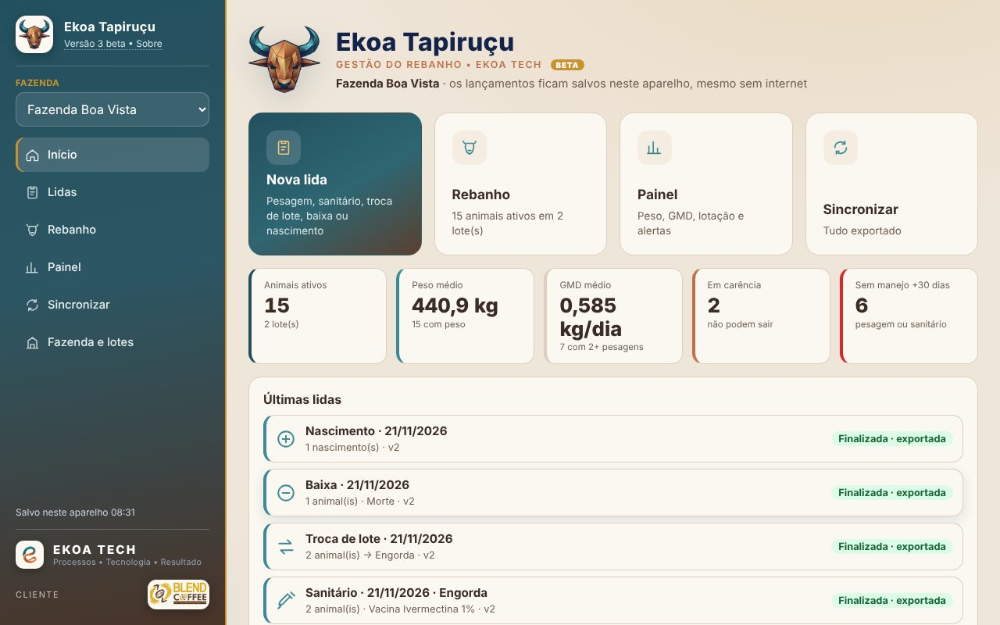
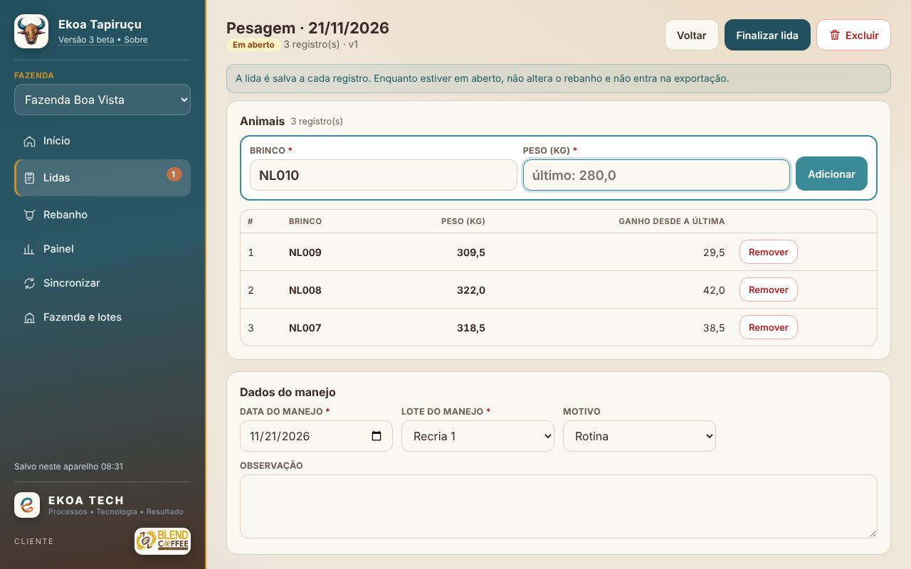
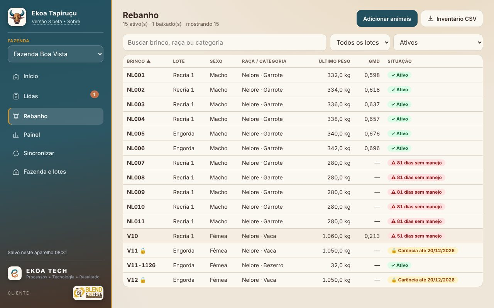
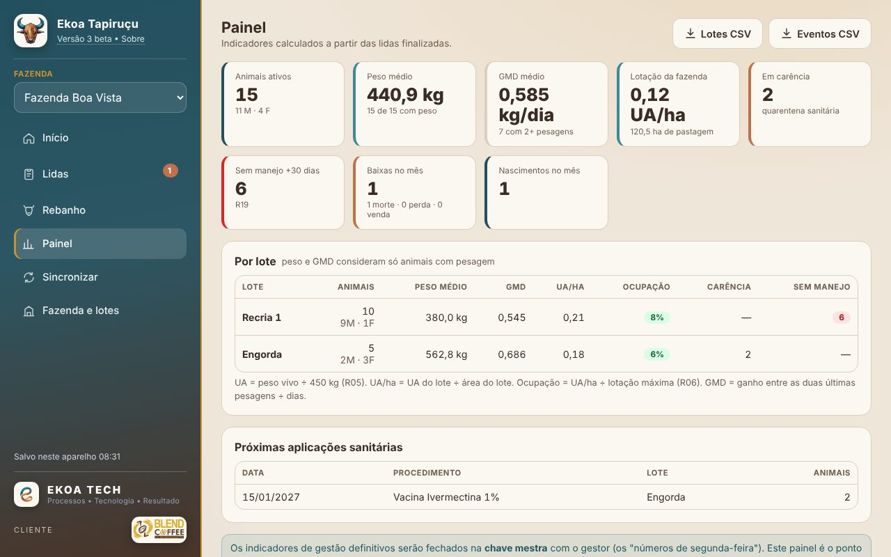
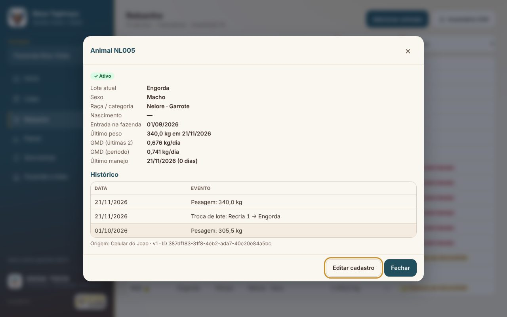
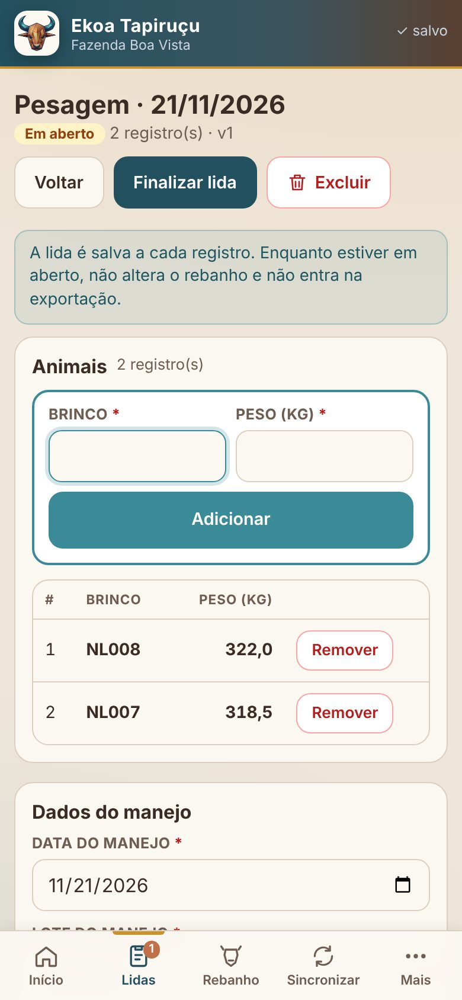
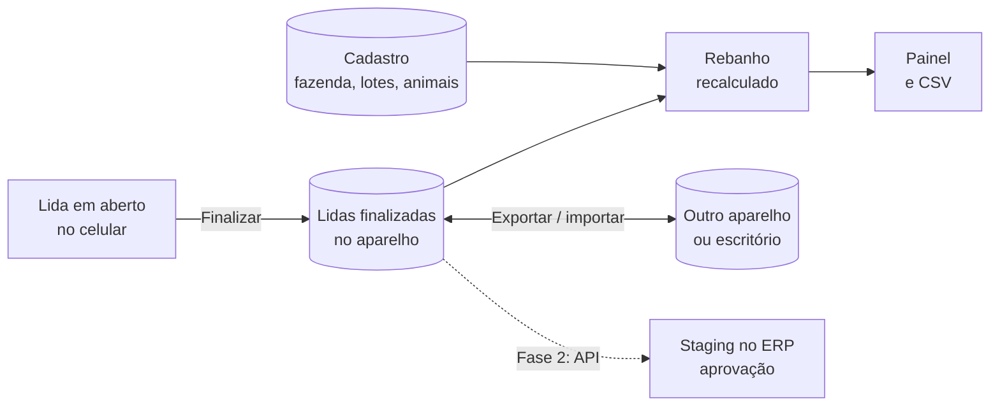

<div align="center">


# Ekoa Tapiruçu

**Registre o manejo do rebanho no campo, mesmo sem internet, e acompanhe peso, ganho diário, lotação e alertas de cada lote.**

[](CHANGELOG.md)
[](#onde-o-piloto-se-encaixa)
[](#instalação)
[](#princípios-de-engenharia)
[](#instalação)

[**Abrir o app**](https://ekoacorp-tech.github.io/ekoatapirucu/) · [Novidades](CHANGELOG.md) · [Arquitetura](docs/arquitetura.md) · [Sincronização](docs/sincronizacao.md) · [Modelo de dados](docs/modelo-de-dados.md) · [Homologação](docs/homologacao.md) · [Publicação](docs/publicacao.md)

</div>

---

## Por que o Tapiruçu existe

Na fazenda, a falta de gestão raramente é falta de sistema. O que falta é o **dado coletado no momento do manejo**, por quem está no curral, com rede ruim e pouco tempo.

O Tapiruçu resolve primeiro essa ponta: cada pesagem, vacina, troca de lote, morte ou nascimento vira um registro com data, lote, aparelho e versão. A partir daí o app calcula, no próprio celular, os indicadores que mostram como o rebanho está evoluindo.

> **Lida de campo → Rebanho atualizado → Indicador → Decisão**

## O que ele faz

<table>
<tr>
<td width="50%"></td>
<td width="50%"></td>
</tr>
<tr>
<td><b>Início.</b> Nova lida a um toque, avisos do que está em aberto e do que ainda não foi exportado, e os números do rebanho.</td>
<td><b>Lida de campo.</b> Brinco, Enter, peso, Enter. O app valida o brinco na hora, mostra o último peso e o ganho, e salva a cada registro.</td>
</tr>
<tr>
<td></td>
<td></td>
</tr>
<tr>
<td><b>Rebanho.</b> Lote atual, último peso, GMD e situação de cada animal: carência sanitária (🔒) e alerta de animal sem manejo há mais de 30 dias.</td>
<td><b>Painel.</b> Peso médio, GMD, UA/ha e ocupação por lote, baixas e nascimentos do mês e próximas aplicações sanitárias.</td>
</tr>
<tr>
<td></td>
<td></td>
</tr>
<tr>
<td><b>Sincronizar.</b> Exportar é o envio. O arquivo leva integridade SHA-256; a importação mostra prévia, faz cópia de segurança e pode ser desfeita.</td>
<td><b>Ficha do animal.</b> Histórico de pesagens, sanidade e trocas de lote, com a origem de cada registro.</td>
</tr>
</table>

<div align="center">
&nbsp;&nbsp;

<br><sub>No celular: alvos de toque grandes, navegação inferior e o foco volta ao brinco a cada lançamento.</sub>
</div>

## Como funciona



1. **Cadastrar:** fazenda, lotes (com área e lotação máxima) e a carga inicial do rebanho, por lista ou faixa de brincos.
2. **Lançar:** cada manejo é uma **lida**. Enquanto está em aberto, ela não altera nada. Ao **finalizar**, o rebanho é recalculado.
3. **Acompanhar:** o Painel mostra peso, GMD, lotação e alertas; o CSV leva tudo para o Excel.
4. **Enviar:** a exportação gera um arquivo que outro aparelho, ou o escritório, importa. Só lidas finalizadas viajam.

### Manejos do piloto

| Lida | O que registra | Efeito ao finalizar |
|---|---|---|
| **Pesagem** | Peso por animal, motivo | Histórico de peso e GMD |
| **Sanitário** | Procedimento, produto, dose, carência, próxima aplicação | Animal em carência até a data (🔒) |
| **Troca de lote** | Lote de destino | Animal muda de lote |
| **Baixa** | Morte, perda ou venda, com causa | Animal sai do inventário |
| **Nascimento** | Vaca, brinco do bezerro, sexo, peso | Bezerro entra no rebanho, no lote da mãe |

Fora do piloto, por decisão de escopo: financeiro, custos e rateio, simulação de venda, reprodução completa, mapa de pastagem, balança e leitor de brinco, integração com o ERP.

## Onde o piloto se encaixa

| Fase | Entrega | Condição para avançar |
|---|---|---|
| 0 | Chave mestra fechada com os indicadores do gestor; credenciamento de desenvolvedor Sankhya pedido; contrato (propriedade, dados, escopo) | Indicadores aprovados |
| **1** | **Este app**: uma fazenda, 2 a 3 usuários, 60 a 90 dias | Métricas de uso definidas na Fase 0 |
| 2 | API de integração (gateway oficial, OAuth 2.0), com fila e reenvio idempotente | Piloto aprovado |
| 3 | Add-on Sankhya com as telas e rotinas de gestão | Dado real chegando ao ERP |

O modelo de dados já nasce pronto para a Fase 2: cada lida e cada registro têm ID único gerado no aparelho, e reenviar o mesmo registro não duplica. Ver [Modelo de dados](docs/modelo-de-dados.md).

## Princípios de engenharia

| Princípio | Como se traduz no app |
|---|---|
| **Offline-first** | Service Worker com cache do app; dados em IndexedDB, no próprio aparelho; armazenamento persistente solicitado ao navegador. |
| **Dois estágios** | A lida em aberto é rascunho. Só a finalizada altera o rebanho e é exportada (regras R01 e R16 do escopo). |
| **Rebanho derivado de eventos** | O estado de cada animal é recalculado a partir do cadastro e das lidas finalizadas, em ordem de data. Nada é "sobrescrito". |
| **Os dados do usuário são intocáveis** | Atualizações não mexem nos dados; cópia de segurança antes de importar ou atualizar; exclusão sempre passa pela lixeira. |
| **Rastreabilidade** | Todo registro carrega ID único, versão, aparelho de origem e de edição, e datas de criação, edição e exportação. |
| **Sincronização sem servidor** | Pacote JSON com integridade SHA-256, mesclagem por versão, registro de exclusões e detecção de conflitos. [Detalhes](docs/sincronizacao.md) |
| **Entrada não confiável** | Todo arquivo importado é validado campo a campo, limitado e exibido de forma segura. |
| **Entrada tolerante** | Peso aceita `452,5`, `452.5` e `1.050`; brincos aceitam lista ou faixa (`NL001-NL050`). |
| **Exportação para planilha** | CSV em UTF-8 com BOM, separador `;`, decimal com vírgula, datas `dd/mm/aaaa`, proteção contra fórmula e IDs no final de cada linha. |
| **Atualização assistida** | O app consulta `version.json`, avisa e atualiza com um toque, sem perder dados. |
| **Sem dependências externas** | HTML, CSS e JavaScript puros. Nenhuma biblioteca, nenhum servidor de aplicação. |

## Instalação

Abra **https://ekoacorp-tech.github.io/ekoatapirucu/** e instale:

- **Android ou computador (Chrome/Edge):** botão **Instalar app** na tela inicial, ou menu do navegador → *Instalar app*.
- **iPhone (Safari):** Compartilhar → **Adicionar à Tela de Início**.

Abra o app uma vez com internet. Depois ele funciona sem conexão. Novas versões são avisadas dentro do próprio app.

## Estrutura do projeto

```text
index.html      app completo: interface, regras, cálculos, sincronização e CSV
sw.js           Service Worker: cache offline e estratégia de atualização
manifest.json   instalação como app (nome, ícones, cores)
version.json    versão publicada e notas, lidas pelo aviso de atualização
icons/          ícones do app
assets/         logo oficial, imagem de capa e telas do README
docs/           arquitetura, sincronização, modelo de dados, homologação e publicação
```

## Roadmap

- [x] PWA offline, instalável em Android, iPhone e computador
- [x] Cadastro de fazenda, lotes e carga inicial do rebanho
- [x] Lidas de pesagem, sanitário, troca de lote, baixa e nascimento
- [x] Painel com peso, GMD, UA/ha, ocupação e alertas
- [x] Sincronização entre aparelhos com integridade, lixeira e desfazer
- [x] Exportação CSV (inventário, eventos e lotes)
- [ ] Indicadores definitivos da chave mestra (Fase 0)
- [ ] Relatório em PDF por lote e por fazenda
- [ ] Integração com o ERP pela API oficial, com fila e reenvio (Fase 2)
- [ ] Add-on Sankhya de gestão (Fase 3)

## Sobre a Ekoa

A **Ekoa** aproxima **processos, tecnologia, informação e pessoas** para gerar resultado. O Tapiruçu nasce do estudo de gestão pecuária de corte para o Grupo Blendcoffee: primeiro garantir o dado de campo, depois levá-lo ao ERP com segurança.

<div align="center">

**Processos que fazem sentido. Tecnologia que sustenta. Informação que orienta. Consultoria que transforma.**

</div>

---

<sub>© 2026 Ekoa Tech. Todos os direitos reservados. O código está visível para avaliação e estudo; o uso, a cópia ou a redistribuição dependem de autorização da Ekoa.<br>
Sankhya e JetBov são marcas de seus respectivos titulares. O Ekoa Tapiruçu é um produto independente da Ekoa e não tem vínculo com elas.<br>
As telas desta página usam dados fictícios.</sub>
