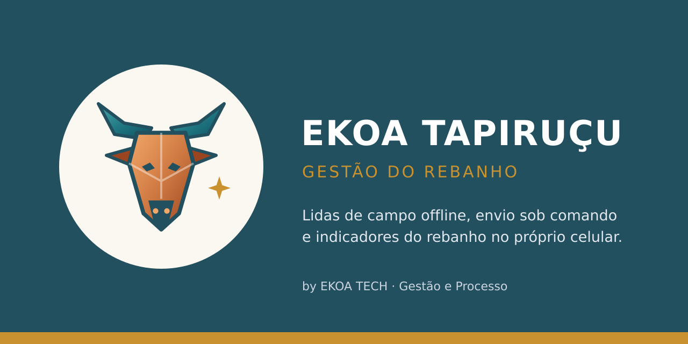
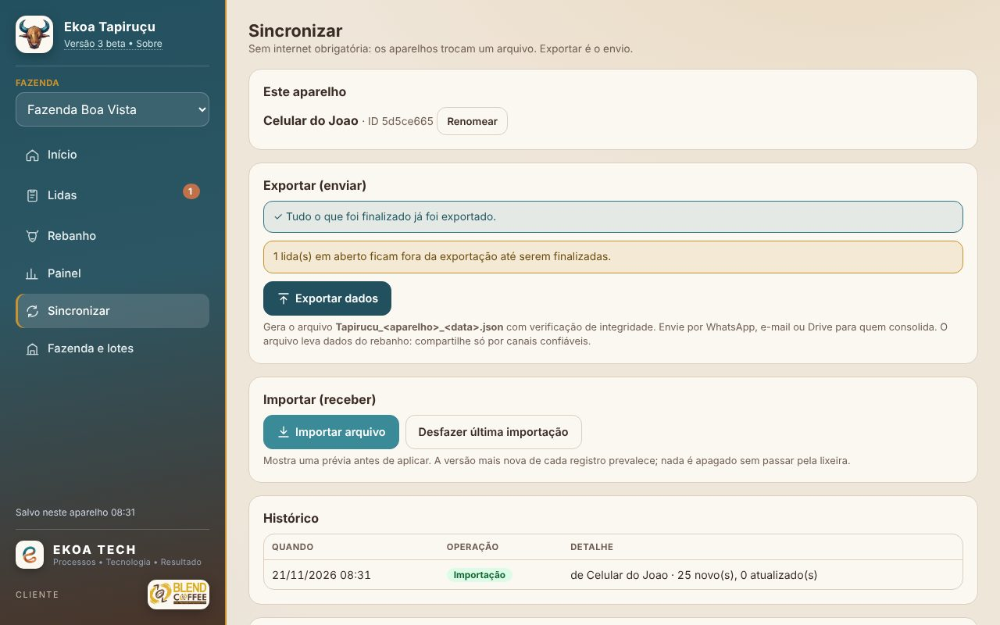
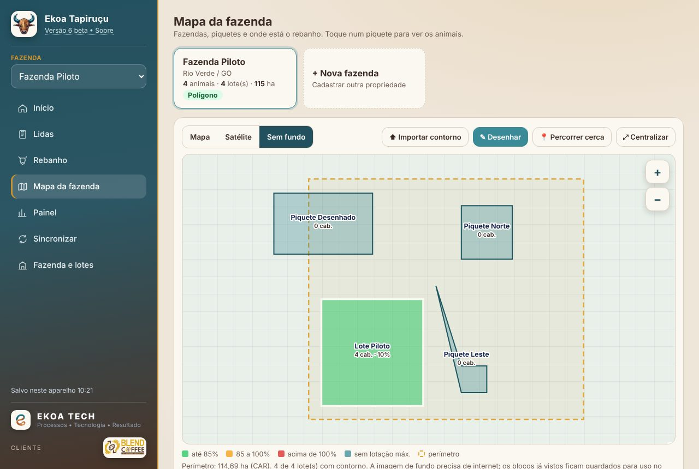
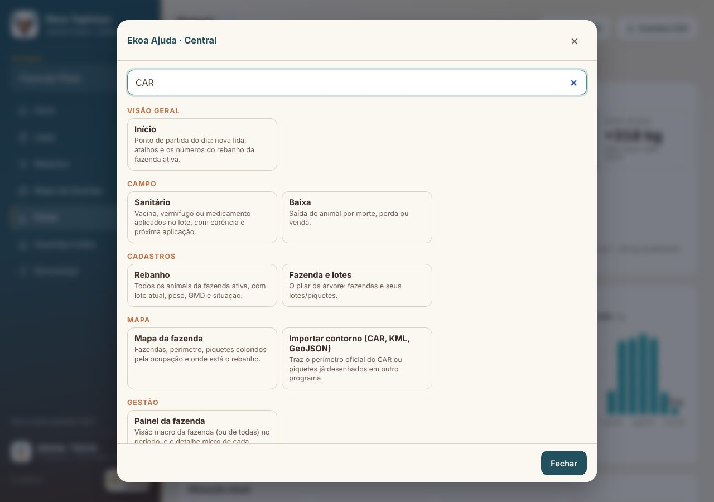
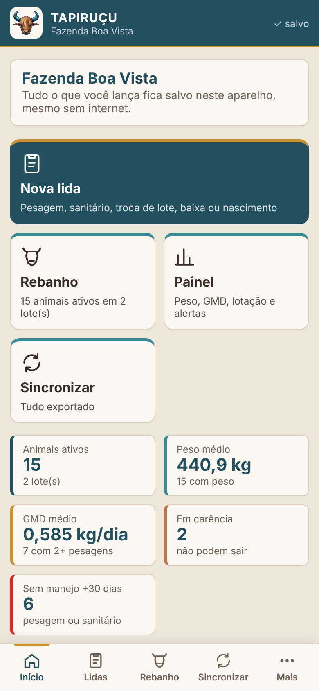
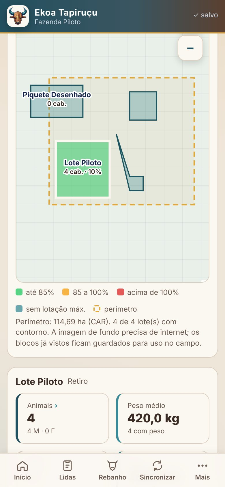
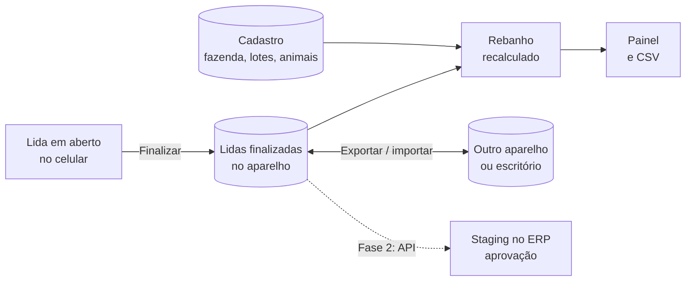

<div align="center">



# Ekoa Tapiruçu

**Registre o manejo do rebanho no campo, mesmo sem internet, e acompanhe peso, ganho diário, lotação, custos e resultado de cada lote.**

[](CHANGELOG.md)
[](#onde-o-piloto-se-encaixa)
[](#instalação)
[](#princípios-de-engenharia)
[](#instalação)

[**Abrir o app**](https://ekoacorp-tech.github.io/ekoatapirucu/) · [Novidades](CHANGELOG.md) · [Arquitetura](docs/arquitetura.md) · [Sincronização](docs/sincronizacao.md) · [Modelo de dados](docs/modelo-de-dados.md) · [Mapa](docs/mapa.md) · [Homologação](docs/homologacao.md) · [Publicação](docs/publicacao.md)

</div>

---

## Por que o Tapiruçu existe

Na fazenda, a falta de gestão raramente é falta de sistema. O que falta é o **dado coletado no momento do manejo**, por quem está no curral, com rede ruim e pouco tempo.

O Tapiruçu resolve primeiro essa ponta: cada pesagem, vacina, troca de lote, morte ou nascimento vira um registro com data, lote, aparelho e versão. A partir daí o app calcula, no próprio celular, os indicadores que mostram como o rebanho está evoluindo.

> **Lida de campo → Rebanho atualizado → Indicador → Custo e resultado → Decisão**

## O que ele faz

<table>
<tr>
<td width="50%"></td>
<td width="50%"></td>
</tr>
<tr>
<td><b>Início.</b> Nova lida a um toque, avisos do que está em aberto e do que ainda não foi exportado, e os números do rebanho.</td>
<td><b>Lida em cascata.</b> Fazenda → lote → animais. O primeiro brinco define o lote, os demais entram na fila; brinco de outro lote pede confirmação e de outra fazenda é recusado.</td>
</tr>
<tr>
<td></td>
<td></td>
</tr>
<tr>
<td><b>Rebanho.</b> Lote atual, último peso, GMD e situação de cada animal: carência sanitária (🔒) e alerta de animal sem manejo há mais de 30 dias.</td>
<td><b>Painel da fazenda.</b> Ganhos e perdas no período, arrobas estimadas e @/ha, evolução de 12 meses, comparativo entre fazendas e detalhe de cada piquete.</td>
</tr>
<tr>
<td></td>
<td></td>
</tr>
<tr>
<td><b>Sincronizar.</b> Exportar é o envio. O arquivo leva integridade SHA-256; a importação mostra prévia, faz cópia de segurança e pode ser desfeita.</td>
<td><b>Ficha do animal.</b> Histórico de pesagens, sanidade e trocas de lote, com a origem de cada registro.</td>
</tr>
</table>

<table>
<tr>
<td width="50%"></td>
<td width="50%"><b>Mapa da fazenda.</b> Perímetro do CAR, piquetes coloridos pela ocupação e o rebanho de cada um. Importe o .zip do CAR, desenhe sobre o satélite ou percorra a cerca com o GPS; a área de cada piquete é calculada e entra na lotação.</td>
</tr>
<tr>
<td></td>
<td><b>Ekoa Ajuda.</b> Um "?" em cada tela com passo a passo, regras, dúvidas e o que conferir no teste beta. Central com busca: "pesar", "CAR", "exportar".</td>
</tr>
</table>

<div align="center">
&nbsp;&nbsp;
&nbsp;&nbsp;

<br><sub>No celular: alvos de toque grandes, navegação inferior e o foco volta ao brinco a cada lançamento.</sub>
</div>

## Como funciona



1. **Cadastrar:** fazenda (com CAR e localização da sede), lotes (com área, lotação máxima e ponto do pasto pelo GPS) e a carga inicial do rebanho, por lista ou faixa de brincos.
2. **Lançar:** cada manejo é uma **lida**. Enquanto está em aberto, ela não altera nada. Ao **finalizar**, o rebanho é recalculado.
3. **Acompanhar:** o Painel mostra peso, GMD, lotação e alertas; o CSV leva tudo para o Excel.
4. **Enviar:** a exportação gera um arquivo que outro aparelho, ou o escritório, importa. Só lidas finalizadas viajam.

### Manejos do piloto

| Lida | O que registra | Efeito ao finalizar |
|---|---|---|
| **Pesagem** | Peso por animal, motivo | Histórico de peso e GMD |
| **Sanitário** | Procedimento, produto, dose, carência, próxima aplicação | Animal em carência até a data (🔒) |
| **Troca de lote** | Lote de destino | Animal muda de lote |
| **Baixa** | Morte, perda ou venda, com causa | Animal sai do inventário |
| **Nascimento** | Vaca, brinco do bezerro, sexo, peso | Bezerro entra no rebanho, no lote da mãe |
| **Mudar de pasto** | Lote, pasto de destino, data | Rotação registrada: dias de ocupação e de descanso por pasto |

### Planejamento e estoque (v29 a v32)

- **Morte com prova** (v29): baixa por morte ou perda com foto e validação do gestor.
- **Vacinas e medicamentos** (v30): entrada de insumo com fabricante, lote, validade, doses e valor de compra; saldo, estoque baixo, vencimento, doses **reservadas** por aplicações do campo ainda por conferir, campanhas e custo sanitário por lote, com a cobertura do que ficou sem custo.
- **Peso de venda** (v31): peso-alvo por animal; o app prevê a data de atingimento pelo histórico de pesagens e avisa quando é hora de pesar para conferir.
- **Ordens de lida** (v31 e v32): o escritório cria a ordem (o que fazer, em quais animais, até quando) ou aceita uma sugestão do app (perda de peso, sem manejo, pesagem vencida, conferência de venda, carência, aplicação atrasada, campanha). A ordem vai ao campo na carga, vira lida e volta feita. Visão unificada de todas as fazendas.

### Custos e resultado (v33 a v37)

| Frente | O que registra | O que o app calcula |
|---|---|---|
| **Compra do lote** | Cabeças, valor, frete, peso na origem, procedência, GTA ou nota | R$ por cabeça, R$ por @ na origem, quebra de transporte |
| **Venda do lote** | Cabeças, valor, arrobas de carcaça, peso na fazenda e no destino, comprador, GTA ou nota; ligada à lida de baixa | R$ por @, rendimento real de carcaça, quebra até o destino |
| **Alimentação** | Produto, tipo, período, kg e custo por lote; sistema do lote (pasto, semi, confinamento) | Custo e kg por cabeça por dia; kg de alimento por kg de ganho no confinamento |
| **Manejo de pasto** | Apontamento do que fazer (adubação, calagem, roçada, invasoras, reforma, cerca, água), prazo, responsável; depois o feito com custo e período de rateio | Rateio diário pelos lotes no pasto, pela UA de cada um; **pasto sem rebanho**; valor a apropriar; manutenção esperada por tempo desde o último manejo |
| **Resultado do lote** | (calculado) | Receita − compra − sanitário − alimentação − pasto, margem por cabeça, custo e preço por @, ponto de equilíbrio, lista do que está fora da conta e **simulador de venda** (hoje × 15 a 90 dias) |
| **Visão da fazenda** | (calculado) | Custo operacional de 12 meses, custo por cabeça-dia, custo por @ produzida, composição dos custos, desfrute, idade ao abate e dias até a venda |

Os custos do lote são repartidos entre os animais que ficaram (vendidos e ativos): morte e perda pesam em quem sobrou. Todo resultado mostra o que ficou sem custo, em vez de esconder a pendência.

### Operação e Gestão (v36)

O menu é dividido em **Operação** (início, lidas, rebanho, mapa, ordens, Modo Campo) e **Gestão** (painel, custos e resultado, insumos, cadastros). A separação está no **arquivo**, não só na tela: a carga para o campo sai sem compra, venda, alimentação e qualquer custo, e o aparelho que a recebe vira de campo, sem a tela de custos. Na volta, o escritório mantém os valores que já tinha. PIN e perfil são conveniência, não criptografia: quem tem o arquivo completo vê tudo.

### Modo Campo

Ligado por aparelho, deixa o app simples para quem trabalha no curral: **uma pergunta por tela**, botões grandes e teclado numérico próprio. Cobre todos os manejos acima, funciona com leitor de brinco por Bluetooth e protege a saída com PIN.

- **Manejo a realizar:** o início mostra, por lote e pasto, os animais sem manejo há mais de 30 dias e as aplicações sanitárias agendadas (vencidas ou dos próximos 7 dias). Tocar no lote mostra os brincos pendentes e deixa escolher a lida, já com o lote preenchido. Repetir uma aplicação agendada traz produto e dose prontos.
- **Característica do animal:** a lista da lida pode mostrar o texto de cada animal (chifre, mancha, temperamento), buscar por ele e editá-lo ali mesmo.
- **Conferência no escritório:** a lida concluída no campo chega como "Do campo, para conferir" e só altera o rebanho quando o gestor finaliza.
- **Ordens do escritório:** o Manejo a realizar mostra também as ordens de lida recebidas na carga; ao concluir, a ordem volta como feita.

### Senha, biometria e e-mail

O app pode pedir uma **senha ao abrir** (com digital ou rosto do aparelho e a opção "lembrar por 1 h a 7 dias"), pensada para demonstrações. Ela **não criptografa os dados**. No cadastro da senha o e-mail é opcional: recebe uma mensagem de boas-vindas e, se a senha for esquecida, um **código de 8 caracteres** que vale 15 minutos. O e-mail fica só no aparelho; o envio é feito pelo serviço descrito em [E-mail e recuperação da senha](docs/email.md), com aviso de privacidade dentro do app.

Fora do piloto, por decisão de escopo: financeiro completo (contas a pagar e receber, fluxo de caixa), reprodução completa, integração com balança e com o ERP. Custos e resultado por lote entraram nas versões 33 a 37 como gestão do rebanho, sem substituir o financeiro do ERP.

## Onde o piloto se encaixa

| Fase | Entrega | Condição para avançar |
|---|---|---|
| 0 | Chave mestra fechada com os indicadores do gestor; credenciamento de desenvolvedor Sankhya pedido; contrato (propriedade, dados, escopo) | Indicadores aprovados |
| **1** | **Este app**: uma fazenda, 2 a 3 usuários, 60 a 90 dias | Métricas de uso definidas na Fase 0 |
| 2 | API de integração (gateway oficial, OAuth 2.0), com fila e reenvio idempotente | Piloto aprovado |
| 3 | Add-on Sankhya com as telas e rotinas de gestão | Dado real chegando ao ERP |

O modelo de dados já nasce pronto para a Fase 2: cada lida e cada registro têm ID único gerado no aparelho, e reenviar o mesmo registro não duplica. Ver [Modelo de dados](docs/modelo-de-dados.md).

## Princípios de engenharia

| Princípio | Como se traduz no app |
|---|---|
| **Offline-first** | Service Worker com cache do app; dados em IndexedDB, no próprio aparelho; armazenamento persistente solicitado ao navegador. |
| **Dois estágios** | A lida em aberto é rascunho. Só a finalizada altera o rebanho e é exportada (regras R01 e R16 do escopo). |
| **Rebanho derivado de eventos** | O estado de cada animal é recalculado a partir do cadastro e das lidas finalizadas, em ordem de data. Nada é "sobrescrito". |
| **Os dados do usuário são intocáveis** | Atualizações não mexem nos dados; cópia de segurança antes de importar ou atualizar; exclusão sempre passa pela lixeira. |
| **Rastreabilidade** | Todo registro carrega ID único, versão, aparelho de origem e de edição, e datas de criação, edição e exportação. |
| **Sincronização sem servidor** | Pacote JSON com integridade SHA-256, mesclagem por versão, registro de exclusões e detecção de conflitos. [Detalhes](docs/sincronizacao.md) |
| **Entrada não confiável** | Todo arquivo importado é validado campo a campo, limitado e exibido de forma segura. |
| **Entrada tolerante** | Peso aceita `452,5`, `452.5` e `1.050`; brincos aceitam lista ou faixa (`NL001-NL050`). |
| **Exportação para planilha** | CSV em UTF-8 com BOM, separador `;`, decimal com vírgula, datas `dd/mm/aaaa`, proteção contra fórmula e IDs no final de cada linha. |
| **Atualização assistida** | O app consulta `version.json`, avisa e atualiza com um toque, sem perder dados. |
| **Sem dependências externas** | HTML, CSS e JavaScript puros. Nenhuma biblioteca, nenhum servidor de aplicação. O mapa, a leitura de shapefile/KML e o cálculo de área são próprios. |

## Instalação

Abra **https://ekoacorp-tech.github.io/ekoatapirucu/** e instale:

- **Android ou computador (Chrome/Edge):** botão **Instalar app** na tela inicial, ou menu do navegador → *Instalar app*.
- **iPhone (Safari):** Compartilhar → **Adicionar à Tela de Início**.

Abra o app uma vez com internet. Depois ele funciona sem conexão. Novas versões são avisadas dentro do próprio app.

## Estrutura do projeto

```text
index.html      app completo: interface, regras, cálculos, sincronização e CSV
sw.js           Service Worker: cache offline e estratégia de atualização
manifest.json   instalação como app (nome, ícones, cores)
version.json    versão publicada e notas, lidas pelo aviso de atualização
icons/          ícones do app
servidor-email/ serviço de envio de e-mail (Gmail/Apps Script ou Cloudflare), com testes
assets/         logo oficial, imagem de capa e telas do README
docs/           arquitetura, sincronização, modelo de dados, homologação e publicação
```

## Roadmap

- [x] PWA offline, instalável em Android, iPhone e computador
- [x] Cadastro de fazenda, lotes e carga inicial do rebanho
- [x] Lidas de pesagem, sanitário, troca de lote, baixa e nascimento
- [x] Painel com peso, GMD, UA/ha, ocupação e alertas
- [x] Sincronização entre aparelhos com integridade, lixeira e desfazer
- [x] Exportação CSV (inventário, eventos e lotes)
- [x] Localização da fazenda e dos pastos pelo GPS, com o modelo de dados pronto para o mapa
- [x] Mapa da fazenda: perímetro do CAR, desenho e trajeto GPS dos piquetes, área calculada e rebanho por piquete ([detalhes](docs/mapa.md))
- [x] Ekoa Ajuda contextual e central de ajuda
- [x] Lidas em cascata (fazenda → lote → animal) e lida em grupo
- [x] Painel da fazenda: ganhos e perdas, evolução, comparativo e detalhe por piquete
- [x] Rotação de pastejo: pasto e lote separados, dias de ocupação e descanso por pasto
- [x] Modo Campo para o curral, com conferência no escritório
- [x] Senha de abertura, biometria e recuperação por e-mail
- [x] Manejo a realizar e característica do animal no Modo Campo
- [x] Relatório em PDF (fazenda, pasto, lote, rebanho, animal)
- [x] Painel em escada e base de confiança dos números
- [x] Morte e perda com prova (foto e validação)
- [x] Vacinas e medicamentos: estoque, validade, reserva, campanhas e custo sanitário
- [x] Peso de venda com previsão de atingimento
- [x] Ordens de lida do escritório para o campo, com sugestões e visão unificada
- [x] Compra e venda do lote, resultado do lote e simulador de venda
- [x] Alimentação e sistema do lote
- [x] Operação × Gestão: carga para o campo sem financeiro
- [x] Custos do pasto com rateio diário por UA e visão financeira da fazenda
- [ ] Manejo de pasto e condição corporal no Modo Campo
- [ ] Teste em aparelhos reais com gestor e vaqueiro
- [ ] Indicadores definitivos da chave mestra (Fase 0)
- [ ] Integração com o ERP pela API oficial, com fila e reenvio (Fase 2)
- [ ] Add-on Sankhya de gestão (Fase 3)

## Sobre a Ekoa

A **Ekoa** aproxima **processos, tecnologia, informação e pessoas** para gerar resultado. O Tapiruçu nasce do estudo de gestão pecuária de corte para o Grupo Blendcoffee: primeiro garantir o dado de campo, depois levá-lo ao ERP com segurança.

<div align="center">

**Processos que fazem sentido. Tecnologia que sustenta. Informação que orienta. Consultoria que transforma.**

</div>

---

<sub>© 2026 Ekoa Tech. Todos os direitos reservados. O código está visível para avaliação e estudo; o uso, a cópia ou a redistribuição dependem de autorização da Ekoa.<br>
Sankhya e JetBov são marcas de seus respectivos titulares. O Ekoa Tapiruçu é um produto independente da Ekoa e não tem vínculo com elas.<br>
As telas desta página usam dados fictícios e são da versão 20; as telas das versões 29 a 37 ainda não têm imagem aqui.</sub>
