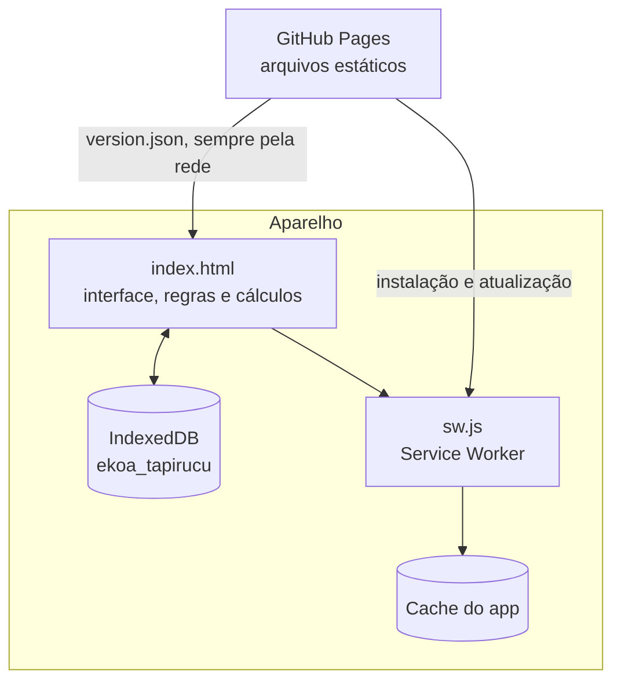

# Arquitetura

O Ekoa Tapiruçu é um **PWA (Progressive Web App)** em HTML, CSS e JavaScript puros, sem dependências externas nem servidor de aplicação. O GitHub Pages entrega os arquivos estáticos; todo o resto acontece no aparelho. É a mesma arquitetura do Ekoa Saber.

## Arquivos

| Arquivo | Responsabilidade |
|---|---|
| `index.html` | Interface, regras de negócio, cálculo do rebanho (`compute()`), Painel, sincronização e CSV. A marca é um SVG embutido. |
| `sw.js` | Cache dos arquivos do app para uso offline. A constante `V` identifica a versão do cache. |
| `manifest.json` | Torna o app instalável (nome, ícones, cores, modo `standalone`). |
| `version.json` | Versão publicada e notas de cada versão; base do aviso de atualização. |

## Dados no aparelho (IndexedDB)

| Chave | Conteúdo |
|---|---|
| `dados` | `fazendas`, `lotes`, `animais`, `lidas`, `lixeira`, `excluidos` e a `fazendaAtiva` |
| `syncMeta` | Aparelho (id e nome), últimas exportações e importações, arquivos já importados, última versão vista |
| `backupPreImport` | Cópia completa feita antes de cada importação (permite "desfazer") |
| `backupPreUpdate` | Cópia completa feita antes de cada atualização |

O modelo de cada registro está em [Modelo de dados](modelo-de-dados.md).

## Rebanho derivado de eventos

O app não guarda "o peso atual" ou "o lote atual" do animal. Ele guarda o **cadastro** e as **lidas**, e a função `compute()` recalcula o estado de cada animal sempre que algo muda:

1. Parte do cadastro (lote de entrada, peso de entrada).
2. Aplica as lidas **finalizadas** da fazenda em ordem de data: pesagem, sanitário, troca de lote, baixa.
3. Deriva último peso, GMD, lote atual, carência, dias sem manejo e situação.

Por isso corrigir uma lida antiga (reabrir e finalizar de novo) corrige automaticamente todo o histórico, e o mesmo princípio serve à integração futura: a lida é o evento, o ERP é quem oficializa.

| Indicador | Cálculo |
|---|---|
| GMD | (último peso − penúltimo peso) ÷ dias entre as duas pesagens. Exige duas pesagens em datas diferentes. |
| GMD do período | (último peso − primeiro peso) ÷ dias entre elas |
| UA | peso vivo ÷ 450 kg (R05) |
| UA/ha | soma das UA do lote ÷ área do lote (R05) |
| Ocupação | UA/ha ÷ lotação máxima do lote, em % (R06) |
| Em carência | data de carência da última aplicação sanitária ≥ hoje (R14) |
| Sem manejo | mais de 30 dias desde a última pesagem ou sanitário, ou desde a entrada (R19) |

## Cache e atualização

| Pedido | Estratégia |
|---|---|
| Tela principal (`./`, `index.html`) | **Rede primeiro**, revalidando o cache HTTP (`no-cache`), com limite de 4 s. Sem sinal ou rede lenta: cópia guardada. |
| Demais arquivos (ícones, logo, manifest) | Cópia guardada primeiro, atualização em segundo plano. |
| `version.json` e pedidos com `?fresh=` | Sempre da rede, nunca da cópia guardada. |

- **Instalação do Service Worker** com `cache: 'reload'` e `skipWaiting`; na ativação, apaga as cópias de versões anteriores e assume as páginas abertas (`clients.claim`).
- **Aviso de versão nova:** o app consulta `version.json` ao abrir, ao voltar para o app e pelo botão "Verificar atualizações".
- **Atualizar agora:** grava os dados, faz cópia de segurança, baixa `index.html?fresh=` direto da rede, **confere se o `APP_VERSION` baixado é o anunciado**, pede ao navegador o service worker novo, espera ele assumir (até 10 s), grava a tela nova nas cópias guardadas e recarrega.
- **Publicação a caminho:** se o servidor ainda entrega a versão anterior (o GitHub Pages guarda arquivos por até 10 minutos), o app avisa para tentar em alguns minutos e não recarrega.
- **Proteção contra ciclo:** se, depois de recarregar, o app abriu numa versão menor que a tentada, ele orienta a reabrir em vez de repetir.

> Lição registrada (v5): nunca baixar a versão nova por um caminho que o service worker atende pela cópia guardada, e nunca recarregar sem conferir a versão recebida. O mesmo padrão existe no Ekoa Saber e deve ser revisado lá.

## Painel da fazenda

| Medida | Cálculo |
|---|---|
| Rebanho inicial e final | Animais com entrada até a data e sem baixa até ela (dia anterior ao início e último dia do período). |
| Ganho de peso | Para cada par de pesagens consecutivas, a diferença proporcional aos dias que caem no período; atribuída ao lote em que o animal estava na pesagem final. |
| GMD do período | Média, por animal, do ganho no período ÷ dias com pesagem no período. |
| Arrobas (estimativa) | Ganho de peso vivo ÷ 30 kg (rendimento de carcaça de 50%). |
| @/ha | Arrobas ÷ área de pastagem (fazenda) ou área do piquete. |
| Perdas | Mortes e perdas ÷ rebanho médio do período (média entre inicial e final). |
| Evolução | Fim de cada um dos últimos 12 meses: cabeças, peso médio (última pesagem até a data) e ganho no mês. |

O cálculo do rebanho é feito por fazenda (`computeF`) e guarda o histórico de lote de cada animal (`loteHist`).

## Mapa

- **Motor próprio** (`class GeoMap`): projeção Web Mercator, blocos de 256 px, desenho dos contornos em SVG, arrastar, aproximar por botões, roda do mouse e dois dedos. Sem bibliotecas.
- **Leitura de arquivos:** .zip (inclusive .zip dentro de .zip) descompactado com `DecompressionStream`; shapefile (.shp + .dbf) lido em binário; KML/KMZ por `DOMParser`; GeoJSON. Tudo validado como entrada não confiável (`okGeoJSON`, até 20.000 vértices, coordenadas em graus).
- **Área:** fórmula geodésica sobre o elipsoide WGS84 (raio 6.378.137 m), descontando furos.
- **Cache dos blocos de fundo:** cache `tapirucu-mapa-v1`, separado do cache do app (não é apagado nas atualizações), com limite de cerca de 4.000 blocos.

## Identificadores estáveis

Não alterar: o banco `ekoa_tapirucu`, o prefixo de cache `ekoa-tapirucu-vN` e o campo `app: "ekoa-tapirucu"` do arquivo de sincronização. Alterá-los apagaria dados dos usuários ou quebraria a compatibilidade entre versões.

## Senha de abertura e e-mail

A senha de abertura é uma camada de demonstração: PBKDF2 (SHA-256, 100 mil voltas, sal próprio) guardado no aparelho, bloqueio após 5 erros e código de recuperação mostrado uma vez. **Não criptografa os dados** do IndexedDB. O e-mail opcional fica no `localStorage` do aparelho, junto de um identificador aleatório do aparelho. Código de nova senha e boas-vindas saem por um serviço externo ao app ([E-mail e recuperação da senha](email.md)); o app chama o serviço com `POST text/plain` e a rota no corpo, sem preflight de CORS.

## Segurança e LGPD

- Arquivos importados são **dados não confiáveis**: cada campo é validado e limitado, IDs fora do padrão são descartados e todo texto é exibido escapado. Arquivo sem integridade, ou com integridade divergente, é recusado.
- Nenhuma credencial fica no app. A integração com o ERP (Fase 2) passará por serviço intermediário com HTTPS e OAuth 2.0; nunca direto do navegador, nunca com AppKey no código.
- Os dados do rebanho são da operação do cliente. O nome do aparelho e do usuário identificam pessoas: os arquivos de sincronização devem circular só por canais confiáveis.
- A custódia dos dados, a propriedade do código e o tratamento de dados pessoais precisam estar definidos em contrato antes do piloto (Fase 0).
