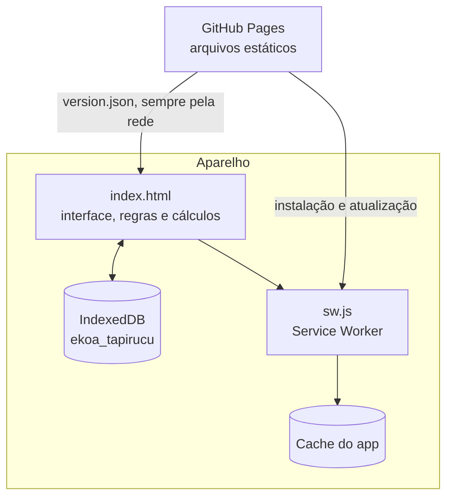

# Arquitetura

O Ekoa Tapiruçu é um **PWA (Progressive Web App)** em HTML, CSS e JavaScript puros, sem dependências externas nem servidor de aplicação. O GitHub Pages entrega os arquivos estáticos; todo o resto acontece no aparelho. É a mesma arquitetura do Ekoa Saber.

## Arquivos

| Arquivo | Responsabilidade |
|---|---|
| `index.html` | Interface, regras de negócio, cálculo do rebanho (`compute()`), Painel, sincronização e CSV. A marca é um SVG embutido. |
| `sw.js` | Cache dos arquivos do app para uso offline. A constante `V` identifica a versão do cache. |
| `manifest.json` | Torna o app instalável (nome, ícones, cores, modo `standalone`). |
| `version.json` | Versão publicada e notas de cada versão; base do aviso de atualização. |

## Dados no aparelho (IndexedDB)

| Chave | Conteúdo |
|---|---|
| `dados` | `fazendas`, `lotes`, `animais`, `lidas`, `lixeira`, `excluidos` e a `fazendaAtiva` |
| `syncMeta` | Aparelho (id e nome), últimas exportações e importações, arquivos já importados, última versão vista |
| `backupPreImport` | Cópia completa feita antes de cada importação (permite "desfazer") |
| `backupPreUpdate` | Cópia completa feita antes de cada atualização |

O modelo de cada registro está em [Modelo de dados](modelo-de-dados.md).

## Rebanho derivado de eventos

O app não guarda "o peso atual" ou "o lote atual" do animal. Ele guarda o **cadastro** e as **lidas**, e a função `compute()` recalcula o estado de cada animal sempre que algo muda:

1. Parte do cadastro (lote de entrada, peso de entrada).
2. Aplica as lidas **finalizadas** da fazenda em ordem de data: pesagem, sanitário, troca de lote, baixa.
3. Deriva último peso, GMD, lote atual, carência, dias sem manejo e situação.

Por isso corrigir uma lida antiga (reabrir e finalizar de novo) corrige automaticamente todo o histórico, e o mesmo princípio serve à integração futura: a lida é o evento, o ERP é quem oficializa.

| Indicador | Cálculo |
|---|---|
| GMD | (último peso − penúltimo peso) ÷ dias entre as duas pesagens. Exige duas pesagens em datas diferentes. |
| GMD do período | (último peso − primeiro peso) ÷ dias entre elas |
| UA | peso vivo ÷ 450 kg (R05) |
| UA/ha | soma das UA do lote ÷ área do lote (R05) |
| Ocupação | UA/ha ÷ lotação máxima do lote, em % (R06) |
| Em carência | data de carência da última aplicação sanitária ≥ hoje (R14) |
| Sem manejo | mais de 30 dias desde a última pesagem ou sanitário, ou desde a entrada (R19) |

## Cache e atualização

- **Estratégia:** responde primeiro pelo cache (para funcionar offline) e atualiza o cache em segundo plano quando há rede.
- **Instalação do Service Worker** com `cache: 'reload'`, para não gravar cópias antigas vindas do cache HTTP.
- **`version.json` nunca passa pelo cache:** o app o consulta ao abrir, ao voltar para o app e pelo botão "Verificar atualizações".
- **Atualizar agora:** espera o último salvamento, faz uma cópia de segurança, baixa os arquivos novos sem cache, substitui o cache e recarrega.

## Identificadores estáveis

Não alterar: o banco `ekoa_tapirucu`, o prefixo de cache `ekoa-tapirucu-vN` e o campo `app: "ekoa-tapirucu"` do arquivo de sincronização. Alterá-los apagaria dados dos usuários ou quebraria a compatibilidade entre versões.

## Segurança e LGPD

- Arquivos importados são **dados não confiáveis**: cada campo é validado e limitado, IDs fora do padrão são descartados e todo texto é exibido escapado. Arquivo sem integridade, ou com integridade divergente, é recusado.
- Nenhuma credencial fica no app. A integração com o ERP (Fase 2) passará por serviço intermediário com HTTPS e OAuth 2.0; nunca direto do navegador, nunca com AppKey no código.
- Os dados do rebanho são da operação do cliente. O nome do aparelho e do usuário identificam pessoas: os arquivos de sincronização devem circular só por canais confiáveis.
- A custódia dos dados, a propriedade do código e o tratamento de dados pessoais precisam estar definidos em contrato antes do piloto (Fase 0).
