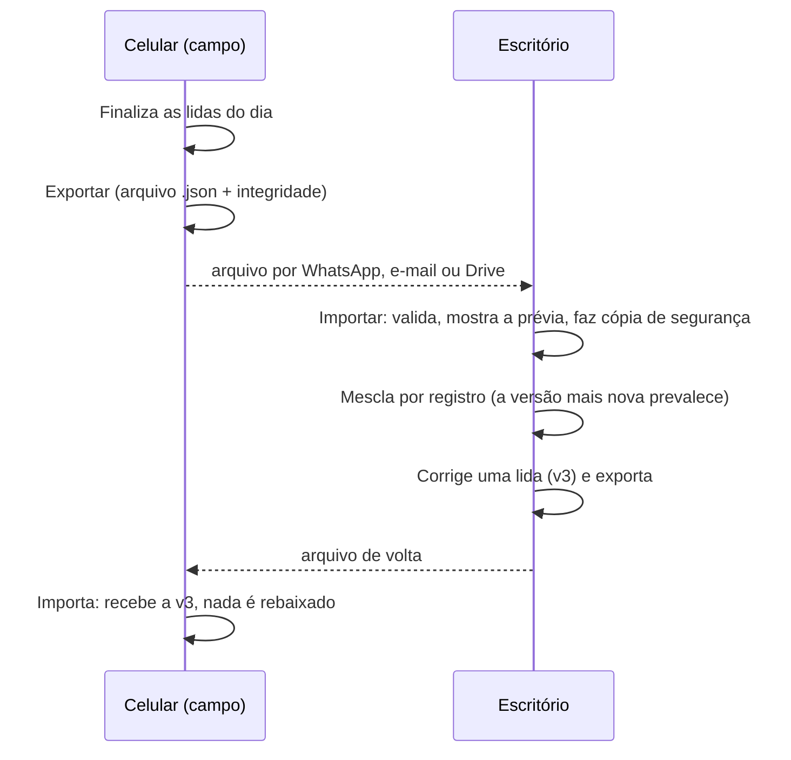

# Sincronização entre aparelhos

Sem servidor, os aparelhos trocam dados por **arquivo**: um exporta, o outro importa. Funciona nos dois sentidos e foi desenhado para **nunca perder nem duplicar** dados. É o mesmo desenho do Ekoa Saber, aplicado a quatro coleções.



## O que viaja

| Viaja | Não viaja |
|---|---|
| Fazendas, lotes, animais | Lidas em aberto (rascunho do aparelho) |
| Lidas **finalizadas** (R16) | Lixeira local |
| Registro de exclusões | Nome e histórico de sincronização do aparelho |

## Formato do arquivo (formato 2)

```text
{ app: "ekoa-tapirucu", formato: 2, versaoApp, exportadoEm, exportadoEmLocal, fusoHorario, exportId,
  dispositivo: { id, nome },
  resumo: { fazendas, lotes, animais, lidas, registros, excluidos },
  dados: { fazendas: [...], lotes: [...], animais: [...], lidas: [...] },
  excluidos: [ { id, tipo, em, no: { id, nome } } ],
  integridade: SHA-256 de { dados, excluidos } }
```

Nome do arquivo: `Tapirucu_<aparelho>_<aaaa-mm-dd_HHhMM>.json`, na **hora local** do aparelho (desde a versão 9; antes saía em UTC, 3 h à frente de Brasília).

**Datas e fuso.** Dentro do arquivo, `exportadoEm` e os carimbos dos registros ficam em UTC (ISO 8601, sufixo `Z`): é o padrão para comparar versões entre aparelhos em fusos diferentes e para a futura integração com o Sankhya. Para leitura humana, o arquivo leva `exportadoEmLocal` (ex.: `21/11/2026 15:02 (UTC-03:00)`) e `fusoHorario` (ex.: `America/Sao_Paulo`). A tela do app sempre mostra no horário local. `exportadoEmLocal` e `fusoHorario` não entram na integridade, então arquivos da versão 8 continuam válidos.

| Formato | Versões do app | Diferença |
|---|---|---|
| 1 | 1 a 3 | Sem geolocalização |
| 2 | 4 em diante | Fazenda com `car` e `geo`; lote com `geo` |

O app importa formatos iguais ou anteriores ao seu. Um aparelho numa versão antiga recusa o formato 2 e pede atualização, o que evita perder a localização numa ida e volta.

## Regras de mesclagem (por ID de cada registro)

| Situação | Resultado |
|---|---|
| O registro não existe aqui | Entra |
| A versão do arquivo é maior | Substitui a daqui |
| A versão daqui é maior | Mantém a daqui (um arquivo antigo nunca rebaixa) |
| Mesma versão e mesmo conteúdo | Igual |
| Mesma versão e conteúdo diferente | **Conflito:** vale a edição mais recente, com aviso na prévia |
| A lida foi reaberta aqui | A edição local em andamento vence, salvo se o arquivo trouxer versão maior |

## Exclusões

Excluir gera um **registro de exclusão** (ID, tipo, data e aparelho), que viaja no arquivo. Sem ele, um registro excluído "ressuscitaria" ao importar um arquivo antigo.

| Situação | Resultado |
|---|---|
| Excluído lá e não editado aqui depois | Vai para a **lixeira** aqui |
| Excluído lá, mas editado aqui **depois** | **Mantido**, com aviso |
| Excluído aqui e o arquivo traz o registro | Continua excluído, salvo se foi editado lá **depois** da exclusão |
| Restaurar da lixeira | Conta como edição (nova versão) e vence exclusões mais antigas |

## Proteções contra erro do usuário

- **Prévia** antes de aplicar, por coleção: o que entra, o que atualiza, o que fica.
- **Desfazer última importação**, com a cópia de segurança feita antes de aplicar.
- **Integridade obrigatória:** arquivo alterado, corrompido ou sem integridade é recusado.
- **Arquivo errado:** PDF, CSV, planilha ou arquivo do Ekoa Saber recebem mensagem explicando qual arquivo usar.
- **Arquivo repetido**, **mais antigo** que outro já importado do mesmo aparelho, ou **do próprio aparelho:** aviso na prévia. No caso do próprio aparelho, a prévia orienta: exporte no aparelho de origem e importe no de destino.
- **Nome do aparelho:** cada aparelho tem nome próprio (ex.: "Celular do João", "Computador do escritório"). O app alerta se o nome digitado for igual ao de uma fazenda, porque isso confunde a origem do arquivo.
- **Registros idênticos:** a comparação usa o registro limpo dos dois lados; reimportar o mesmo arquivo mostra tudo como "iguais", sem falso conflito (corrigido na versão 9).
- **Lidas em aberto:** a exportação avisa que elas ficam de fora.
- **Exportação cancelada** (o usuário fechou o compartilhamento): nada é marcado como exportado.

## Rumo à Fase 2

O arquivo de sincronização já é o contrato de dados da integração. A API recebe as mesmas lidas finalizadas, com os mesmos IDs, e grava em área de pendência (staging) no ERP para aprovação. Ver [Modelo de dados](modelo-de-dados.md).
